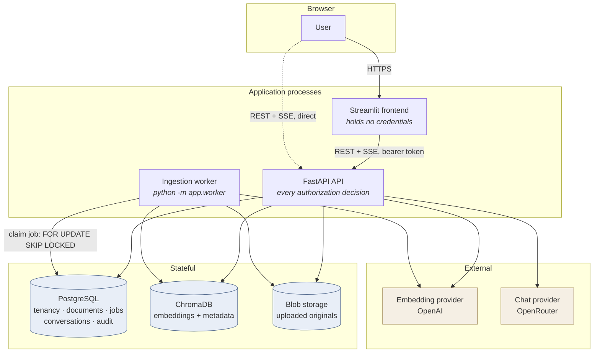
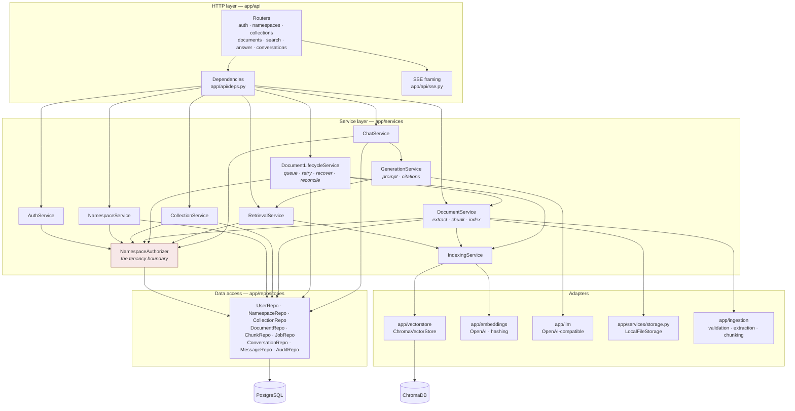
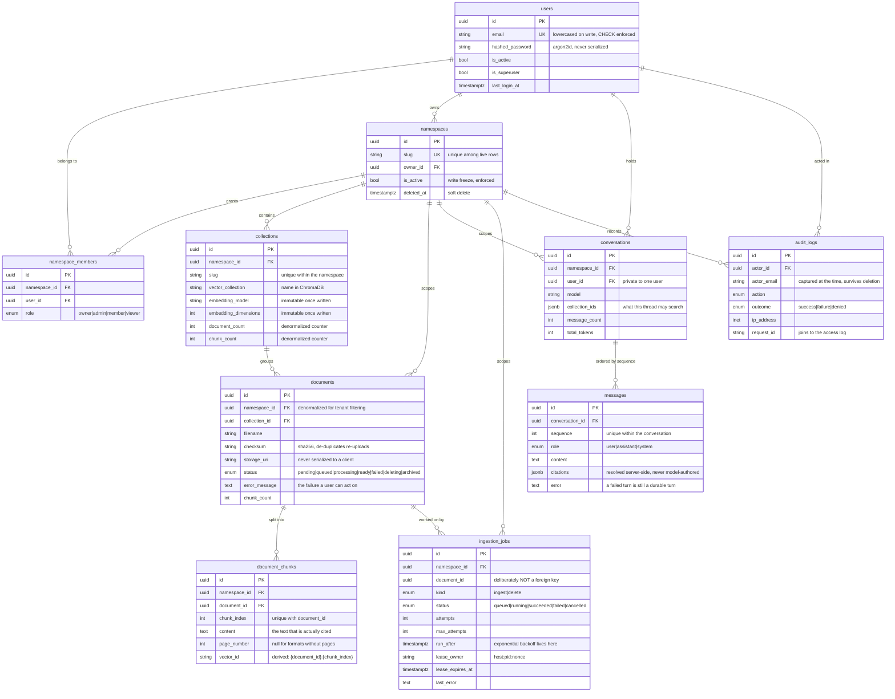
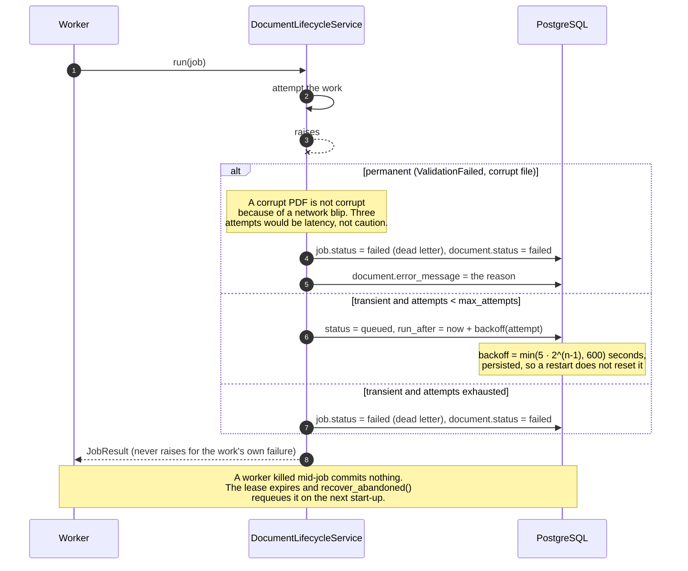
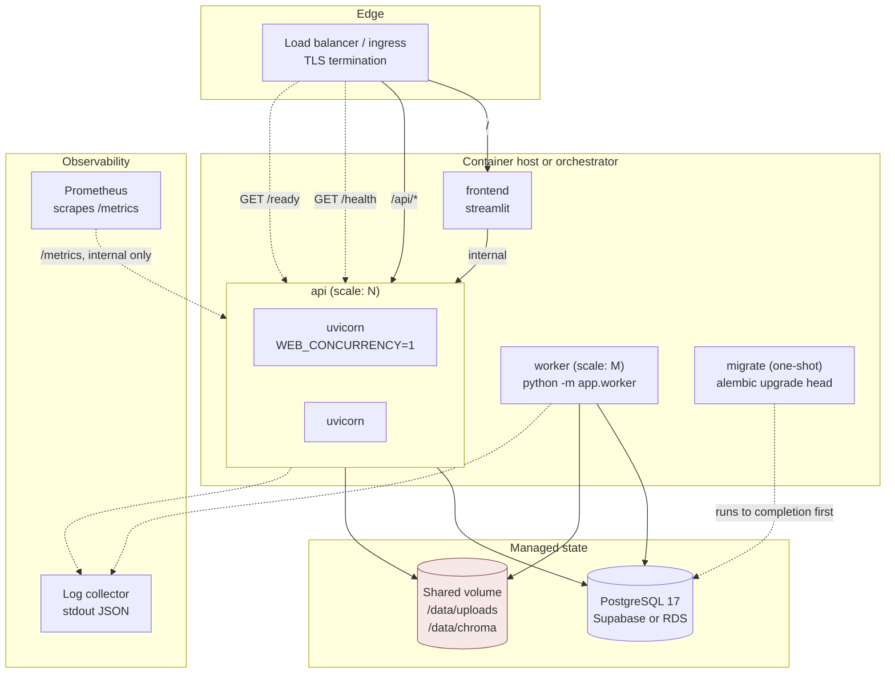

# Architecture

> Written for engineers joining the project or reviewing it. It explains what
> the system is made of and why each boundary falls where it does. Diagrams
> are Mermaid and render on GitHub.

---

## 1. High-level architecture

Four processes and three stores. The arrows are the only ways data moves.



**What the picture is asserting.**

- The frontend never reaches a store or a provider. It knows one URL and
  forwards the signed-in user's bearer token. Compromising it yields the
  tokens of whoever is signed in and nothing more — no database password, no
  API key, no signing secret.
- The API and the worker run the same code and share the same stores. The
  worker is not a different implementation of ingestion; it is the same
  `DocumentLifecycleService` with a different trigger.
- There is no message broker. The queue is a PostgreSQL table, so a job and
  the document row it concerns are updated in one transaction. See
  [trade-offs](trade-offs.md#why-postgresql-is-the-queue).
- The dotted arrow is real: the API is a complete product on its own and the
  Streamlit app is one client of it.

---

## 2. Component view

Layers, and the rule that each one may only call downward.



**The rules this layering encodes.**

1. **A router never touches a repository.** Handlers parse, delegate and
   serialize. Everything that decides anything lives in a service, which is
   what makes the whole decision surface testable without HTTP.
2. **Every namespace-scoped service call starts at `NamespaceAuthorizer`.**
   There is no path to a tenant's data that does not pass through it; a
   service receives a verified `NamespaceContext`, not a namespace id.
3. **Adapters are swappable and the services do not know which one they
   have.** `EMBEDDING_PROVIDER=hash` substitutes deterministic offline
   embeddings for the whole test suite without a single mock in the
   retrieval path.

---

## 3. Entity-relationship model



**Four decisions in that schema worth defending.**

- **`namespace_id` is denormalized onto `documents`, `document_chunks` and
  `ingestion_jobs`.** It is reachable by joining through `collections`, so
  this is redundant by the rules of normalization. It is there because every
  tenant-scoped query filters on it, and a filter that needs a join is a
  filter someone eventually forgets to write. A composite foreign key
  `(namespace_id, collection_id) → collections(namespace_id, id)` makes the
  database reject a row whose two ancestors disagree, so the redundancy
  cannot drift.

- **`ingestion_jobs.document_id` has no foreign key.** A job's reason to
  exist outlives its document: the `delete` job runs *after* the row is
  archived and must still be able to finish, and a hard delete must not
  cascade away the record of what was done. The job handles a missing
  document explicitly (it succeeds — there is nothing left to do).

- **Counters on `collections` are denormalized.** `COUNT(*)` over documents
  and chunks on every collection listing is the obvious alternative and is
  what the first version did; it is also a sequential scan per row rendered.
  They are updated as deltas inside the same transaction as the work, and
  `POST .../reconcile` recomputes them, so a drift is detectable and
  repairable rather than permanent.

- **Soft deletes (`deleted_at`) on namespaces, collections, documents and
  conversations.** Deletion in a multi-tenant system is the operation users
  regret, and a soft delete is the difference between a support ticket and a
  restore from backup. The cost is honest and documented: a partial unique
  index is required for slug reuse, and `uq_collections_namespace_id_slug` is
  currently *not* partial — see the [audit](audit.md#known-gaps).

---

## 4. Request sequences

### 4.1 Upload and ingestion (`INGESTION_MODE=background`)

```mermaid
sequenceDiagram
    autonumber
    actor U as User
    participant API as FastAPI
    participant V as Validation
    participant FS as Blob storage
    participant PG as PostgreSQL
    participant W as Worker
    participant E as Embeddings
    participant CH as ChromaDB

    U->>API: POST .../documents (multipart)
    API->>API: authorize(user, namespace) → role
    API->>API: require_write() + require_active_collection()
    API->>V: sniff magic bytes, check size and extension
    Note over V: The declared content-type is never trusted;<br/>a .docx must contain word/document.xml
    V-->>API: FileKind
    API->>FS: put(bytes) → storage_uri
    API->>PG: INSERT document (status=queued)
    API->>PG: INSERT ingestion_jobs (kind=ingest, status=queued)
    Note over PG: Partial unique index on (document_id, kind)<br/>where status IN (queued, running):<br/>a double-submit cannot enqueue twice
    API->>PG: COMMIT
    API-->>U: 201 {status: "queued"}

    loop poll
        W->>PG: SELECT ... FOR UPDATE SKIP LOCKED
    end
    PG-->>W: job (lease_owner, lease_expires_at set)
    W->>PG: status=processing
    W->>FS: get(storage_uri)
    W->>W: extract text + page numbers
    W->>W: chunk (token-bounded, overlapping)
    W->>E: embed(chunks) in batches
    E-->>W: vectors
    W->>CH: upsert(id = "{document_id}:{index}", metadata = tenant triple)
    W->>CH: delete chunks with index >= new count
    Note over CH: Upsert-then-prune. Re-running converges<br/>instead of leaving orphans from a longer<br/>previous version.
    W->>PG: replace chunk rows, status=ready, counters += delta
    W->>PG: mark job succeeded — one COMMIT with all of the above
```

With `INGESTION_MODE=inline` the job row is written identically and then run
inside the request. The mode decides *who* runs the job, never whether a
crash loses it.

### 4.2 Failure and bounded retry



### 4.3 Streaming an answer (SSE)

```mermaid
sequenceDiagram
    autonumber
    actor U as User
    participant API as FastAPI
    participant PG as PostgreSQL
    participant R as RetrievalService
    participant CH as ChromaDB
    participant G as GenerationService
    participant LLM as OpenRouter

    U->>API: POST .../conversations/{id}/messages
    API->>PG: authorize + load conversation (owner only)
    API->>PG: INSERT user message (durable before any model call)
    API->>R: search(query, collection)
    R->>CH: query(embedding, where = tenant triple, top_k)
    CH-->>R: vector ids + scores
    R->>PG: resolve ids → live chunk rows
    Note over R,PG: Hits with no live chunk are dropped.<br/>This is what makes a soft delete<br/>immediately effective even if the<br/>vector purge has not landed yet.
    R-->>API: passages
    API-->>U: event: start {retrieved_count}

    alt passages found
        G->>LLM: chat.completions (stream=true)
        loop each delta
            LLM-->>G: token
            G-->>U: event: token {delta}
        end
        LLM-->>G: finish
        G->>G: resolve [n] markers against the retrieved set
        Note over G: A marker naming a passage that was<br/>not supplied is deleted from the prose.<br/>The model cannot invent a citation.
        API->>PG: INSERT assistant message + citations
        API-->>U: event: done {citations, usage}
    else nothing retrieved, or the model refuses
        API->>PG: INSERT assistant message (refusal)
        API-->>U: event: done {citations: []}
    end

    opt upstream failure mid-stream
        LLM--xG: timeout / 429 / 5xx
        API->>PG: INSERT assistant message with partial text + error
        API-->>U: event: error {message}
        Note over U,PG: The status line is already 200 by now,<br/>so the failure must arrive in-band.<br/>The question stays saved; retrying is free.
    end

    opt client disconnects
        U--xAPI: connection closed
        API->>PG: persist whatever was generated
        Note over API: The generator is cancelled, but the<br/>tokens already paid for are not thrown away.
    end
```

---

## 5. Deployment



**The shaded box is the scaling limit of this deployment, stated plainly.**
`/data/chroma` is an embedded Chroma store backed by SQLite on a shared
volume. One writer is safe. Several API replicas plus several workers writing
to one network volume is not — SQLite's locking assumes a local filesystem,
and NFS or EBS multi-attach does not provide what it assumes. Until Chroma
runs as its own service (`CHROMA_HOST`), scale the API behind the load
balancer and keep **one** writer: `INGESTION_MODE=background` with a single
worker replica. The full argument, and what to do instead, is in
[trade-offs.md](trade-offs.md#chromadb-persistence-and-its-limits).

**Probe wiring.** `/health` is the liveness probe — restart on failure.
`/ready` is the readiness probe — drain on failure. Using `/ready` for
liveness turns a database failover into a fleet-wide crash loop, so the two
are deliberately separate endpoints with separate semantics.

**Ordering.** `migrate` runs to completion before `api` and `worker` start.
No application process issues DDL: several replicas booting together would
race, and the running schema would drift from the migration history.

---

## Related documents

| Document | What it answers |
|---|---|
| [environment.md](environment.md) | Every variable, what it does, what happens if it is wrong |
| [api.md](api.md) | The HTTP surface, with request and response shapes |
| [trade-offs.md](trade-offs.md) | Why each major decision went the way it did, and its cost |
| [troubleshooting.md](troubleshooting.md) | Symptoms, causes, fixes |
| [audit.md](audit.md) | What was found, what was fixed, what is still open |
