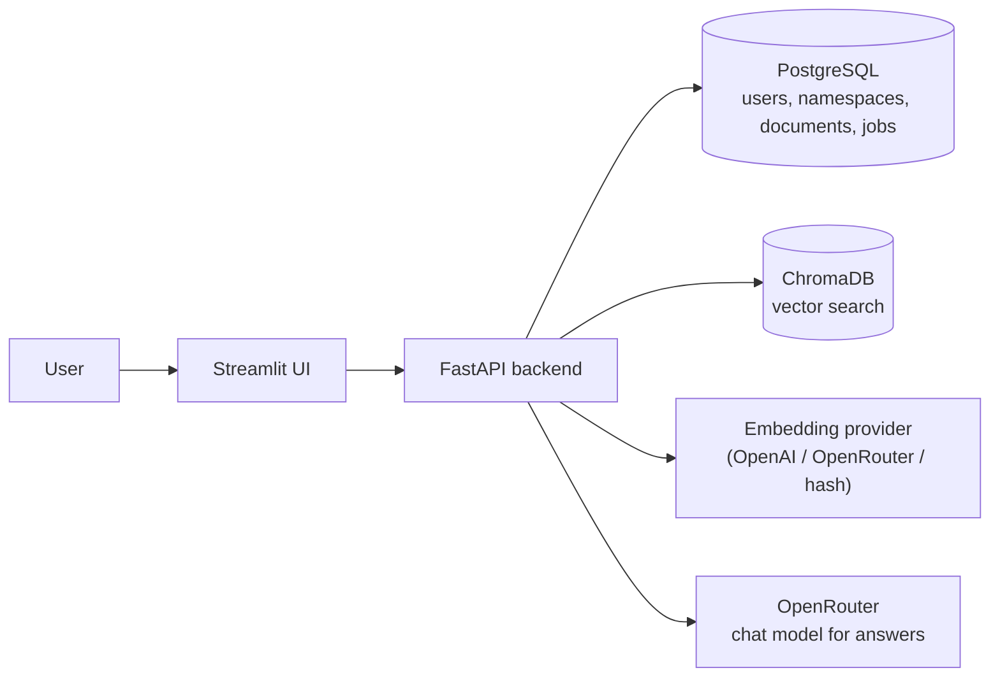

# Architecture (simple view)

How a request flows through the system, at the level needed to explain it in
a demo.

**How to read it**

- The **Streamlit UI** is just a client. It calls the FastAPI backend over
  HTTP and holds no database password or API key.
- **FastAPI** is where every decision is made: who you are, what you're
  allowed to see, and what to do with a request.
- **PostgreSQL** stores everything structured: users, workspaces
  (namespaces), documents, chunks and background jobs.
- **ChromaDB** stores only the vector embeddings used for similarity search.
- The **embedding provider** turns text into vectors when a document is
  uploaded and when a question is asked. It is configured separately from
  the chat model (`EMBEDDING_PROVIDER`), because not every provider that can
  chat can also embed.
- **OpenRouter** is the chat model used to generate the final answer from the
  retrieved passages.

For the full, detailed version of this diagram (with the ingestion worker,
layering rules and more context), see [architecture.md](../architecture.md).
