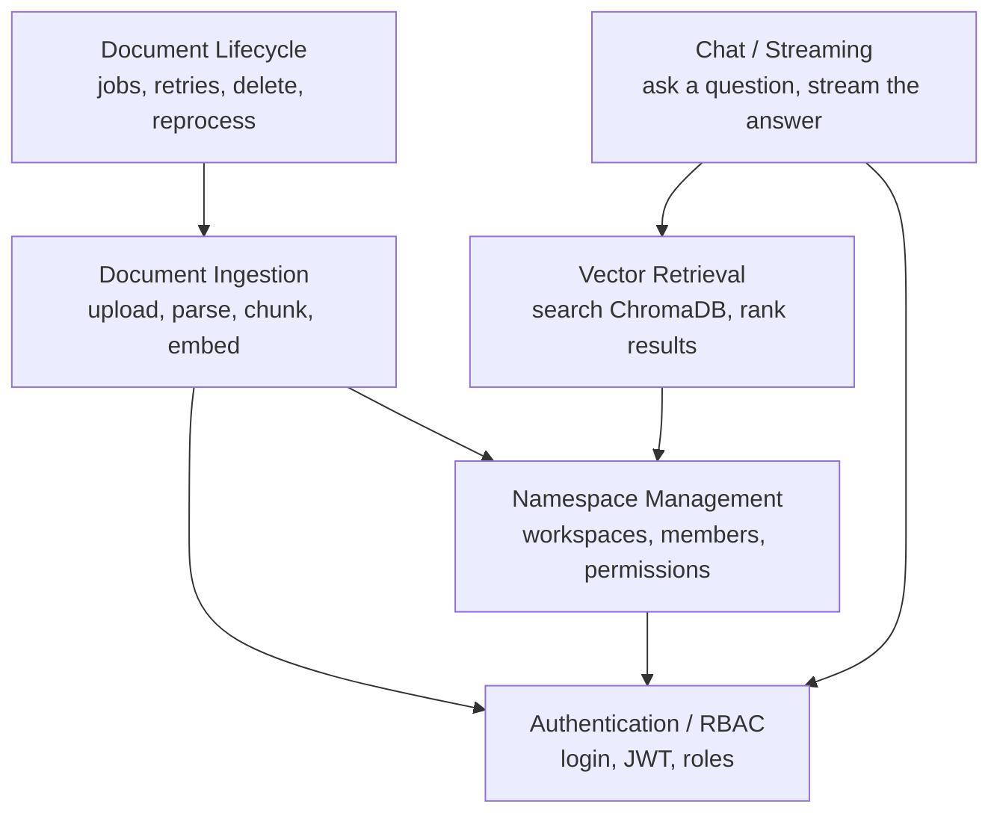

# Components (simple view)

The main modules inside the backend and how they depend on each other.

**What each module does**

- **Authentication / RBAC** — registers and logs in users, issues JWTs, and
  defines the four roles (owner, admin, member, viewer).
- **Namespace Management** — workspaces ("namespaces") that isolate one
  team's data from another's, plus who is a member of each one and with
  what role.
- **Document Ingestion** — validates an uploaded file, extracts its text,
  splits it into chunks, and turns those chunks into embeddings.
- **Vector Retrieval** — given a question, searches ChromaDB for the most
  relevant chunks and resolves them back to real database rows.
- **Chat / Streaming** — orchestrates a question: calls retrieval, sends the
  passages and question to the LLM, and streams the answer back with
  citations.
- **Document Lifecycle Management** — runs ingestion as a background job
  with retries, handles re-processing a document, and handles deletion
  (including cleaning up its vectors).

Every module above sits behind **Authentication / RBAC** — nothing in the
system reads or changes data without first checking who the caller is and
whether they are allowed to.
