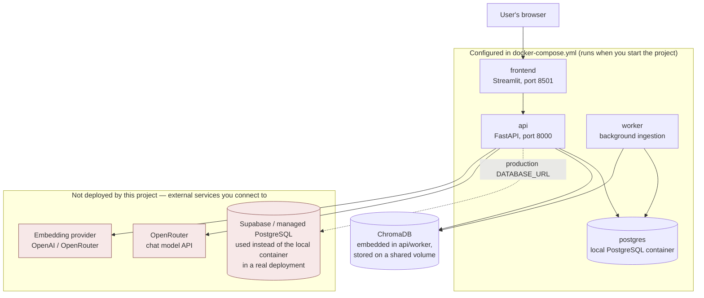

# Deployment (simple view)

What `docker compose up` actually starts, versus what is only ever
*configured as an environment variable* and not something this project
deploys.

**What is actually running when you use Docker**

`docker compose up` starts five containers: `postgres`, a one-shot
`migrate` step, `api`, `worker`, and `frontend`. ChromaDB is **not** a
separate container — it runs embedded inside the `api` and `worker`
containers and stores its index on a shared Docker volume.

**What is not part of this deployment**

- A production database (e.g. Supabase) — the compose file uses its own
  local PostgreSQL container. Pointing `DATABASE_URL` at Supabase instead is
  a configuration change, not something this project sets up for you.
- OpenRouter and the embedding provider are external, third-party APIs
  reached over the internet with an API key. Nothing about them is deployed
  or hosted by this project.
- There is no load balancer, CDN or monitoring stack included — those would
  be added by whoever hosts this in production.

For the full deployment diagram with scaling notes and probe wiring, see
[architecture.md](../architecture.md#5-deployment).
