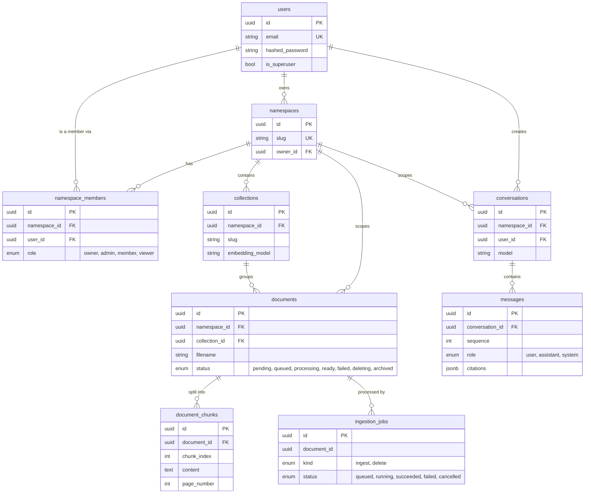

# Entity-relationship diagram (simple view)

The real tables from `app/db/models/`, with only the fields that matter for
understanding the relationships.

**How to explain it in one minute**

- A **user** owns and is a member of one or more **namespaces**
  (workspaces), with a role per namespace.
- A namespace contains **collections**, and each collection contains
  **documents**.
- Each document is split into **document_chunks** — the actual text passages
  that get embedded and searched.
- An **ingestion_job** tracks the background work of processing a document
  (so uploads can be retried if they fail, without blocking the request).
- A **conversation** belongs to one user and one namespace, and holds an
  ordered list of **messages**. Each assistant message stores its citations
  — the exact chunks the answer was based on.

This matches the real SQLAlchemy models in `app/db/models/`; no table or
relationship here is invented. For every column, constraint and index, see
the full version in [architecture.md](../architecture.md#3-entity-relationship-model).
