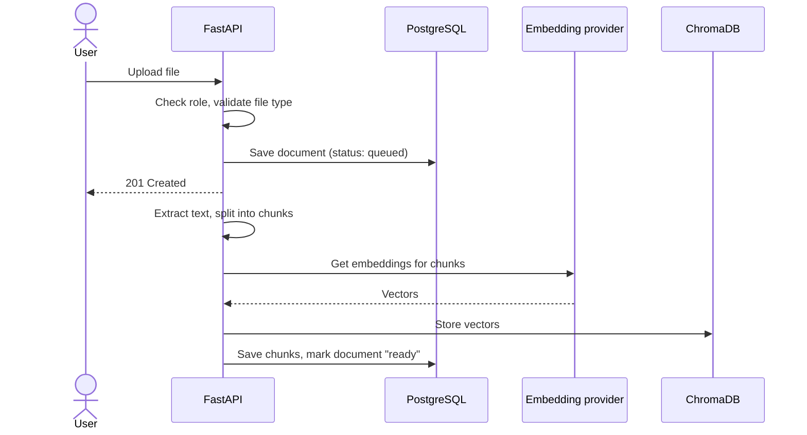
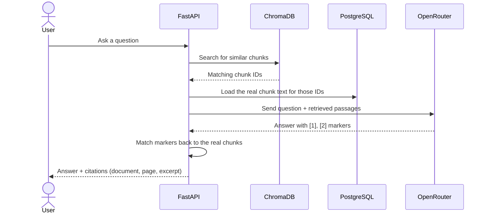
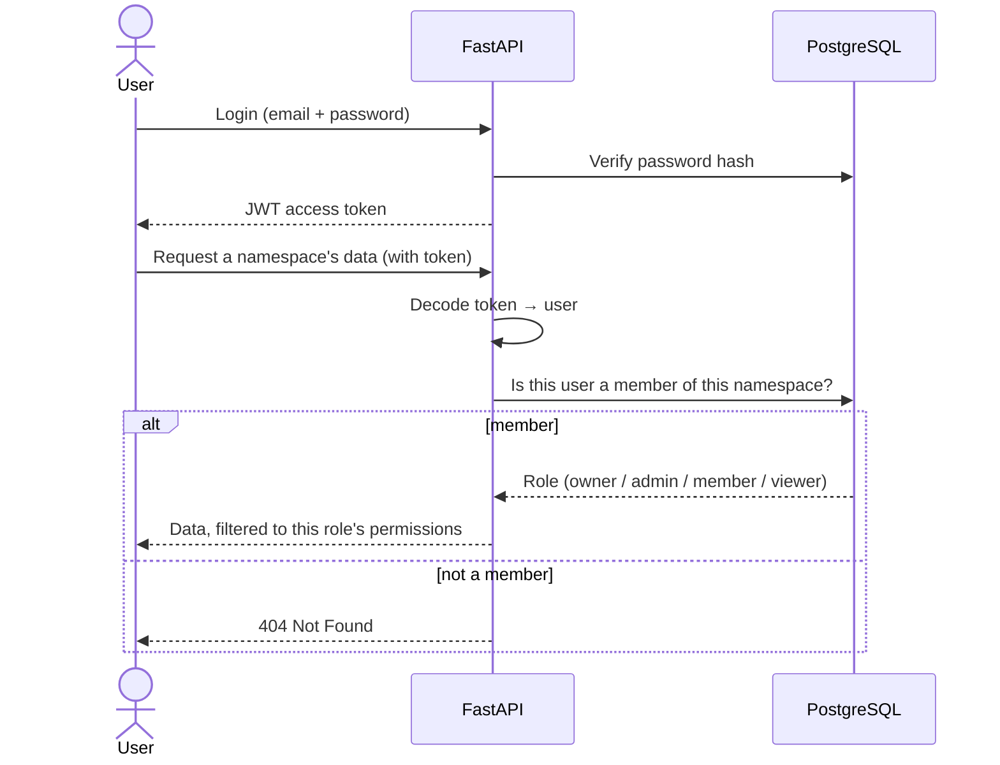

# Sequence diagrams (simple view)

Three flows, kept short enough to narrate out loud.

## 1. Uploading and ingesting a document

## 2. Asking a question (retrieval + citations)

The citation markers are resolved by the backend against the chunks it
actually sent — the model cannot invent a source that wasn't retrieved.

## 3. Logging in and accessing a namespace

Note that a namespace the user is not a member of returns **404**, not
**403** — this prevents someone from even confirming that a workspace exists
by probing its ID.
